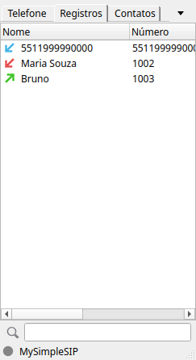

# MySimpleSIP

**Softphone SIP para Linux** — um port nativo e fiel do [MicroSIP](https://www.microsip.org/) 3.22.16
(Windows) para o Ubuntu 26.04 LTS, escrito em C++20 com Qt 6 e o mesmo motor SIP do original
([PJSIP](https://www.pjsip.org/)). Código aberto, licença GPL-2.0-or-later.

> 🇬🇧 *MySimpleSIP is a native Linux port of the MicroSIP 3.22 softphone (Windows), built with
> C++20, Qt 6 and PJSIP. It aims to reproduce MicroSIP's features, layout and behaviour on
> Ubuntu 26.04. The documentation is in Brazilian Portuguese.*



> **Situação: versão de desenvolvimento (0.5.x).** O aplicativo já é usado em chamadas reais,
> mas ainda não chegou à versão estável 1.0.0. Até lá não há pacote pronto: a instalação é
> pela compilação do código-fonte (≈ 10 minutos, passo a passo abaixo). Na 1.0.0 será
> publicado um pacote `.deb` na página de [Releases](https://github.com/GGTY81/MySimpleSIP/releases).

## Recursos

**Já funcionam**

- Contas SIP (UDP, TCP, TLS, SRTP/DTLS), registro, conta local para chamadas por IP.
- Discador com teclado, histórico de números, DTMF, volumes e indicador de nível (VU).
- Chamadas de saída e de entrada; janela de chamada recebida (Atender, Atender com vídeo,
  Recusar, Desviar); várias chamadas simultâneas em abas; espera, mudo, atendimento
  automático, não perturbe, encaminhamento, recusa de chamadas.
- Transferência cega e assistida, conferência (mesclar/separar), captura de chamada e
  códigos de função do PBX.
- Gravação de chamadas em MP3 ou WAV (manual ou automática).
- Histórico de chamadas (SQLite) com busca, ordenação, exportação/importação CSV.
- Agenda de contatos (`Contacts.xml`, compatível com o MicroSIP) com favoritos, busca,
  exportação CSV/XML e importação CSV (inclusive do Google/Outlook).
- Presença/BLF dos contatos e diretório de usuários remoto (XML, JSON, CSV, Yealink).
- Aviso de correio de voz (MWI), comandos externos por evento, desligamento automático.
- Janela de Configurações completa (áudio, codecs, rede, gravação, atendimento, etc.).
- Áudio pelo PipeWire/PulseAudio: os dispositivos aparecem com os nomes do sistema e o
  "Padrão" segue o dispositivo padrão do GNOME (inclusive fones Bluetooth).
- Ícone na bandeja, instância única, senhas guardadas no chaveiro do GNOME, interface em
  português (e nos demais idiomas dos langpacks do MicroSIP).

**Em andamento** (veja o [plano](docs/ANALISE_E_PLANO.md))

- Atalhos/discagem rápida, teclas de atalho do menu, exportar/importar configuração e
  mensagens SIP (chat) — Fase 6.
- Integração com o sistema (teclas de mídia, fones USB HID, mudança de rede, links `sip:`) — Fase 7.
- Vídeo — Fase 8. Pacote `.deb` e Release — Fase 9 (versão 1.0.0).

## Instalação no Ubuntu 26.04

O guia completo, com explicações e solução de problemas, está em
**[docs/INSTALACAO.md](docs/INSTALACAO.md)**. Resumo:

```bash
sudo apt install git
git clone https://github.com/GGTY81/MySimpleSIP.git
cd MySimpleSIP
sudo ./scripts/install-deps.sh          # dependências (uma vez)
./build.sh                              # compila o pjproject e o aplicativo
./scripts/install-desktop-entry.sh      # atalho no menu de aplicativos (opcional)
./build/src/mysimplesip                 # abre o MySimpleSIP
```

Para atualizar depois: `git pull && ./build.sh`.

## Uso rápido

1. Na primeira execução, o diálogo **Conta** abre sozinho: preencha servidor SIP, usuário,
   domínio e senha (a senha vai para o chaveiro do GNOME, não para o arquivo de configuração).
2. Disque pelo teclado ou digite o número e pressione **Chamar** (ou Enter).
3. Fechar a janela só a esconde: o MySimpleSIP continua na bandeja recebendo chamadas.
   Para sair, use o menu (botão ▾ ao lado das abas) → **Sair**.
4. Ajustes em menu → **Configurações**. Para ver a janela de chamadas com abas,
   transferência e conferência, desmarque **Modo Chamada Única**.

Arquivos do usuário:

| O quê | Onde |
|---|---|
| Configurações (mesmo formato do `MicroSIP.ini`) | `~/.config/MySimpleSIP/MySimpleSIP.ini` |
| Contatos, histórico | `~/.local/share/MySimpleSIP/` (`Contacts.xml`, `call_log.db`) |
| Log do SIP (se habilitado) | `~/.local/state/MySimpleSIP/MySimpleSIP_log.txt` |
| Gravações | pasta escolhida nas Configurações (padrão: `~/Recordings`) |

É possível trazer contatos do MicroSIP do Windows copiando o `Contacts.xml` para a pasta acima.

## Documentação

| Documento | Conteúdo |
|---|---|
| [docs/INSTALACAO.md](docs/INSTALACAO.md) | Instalação passo a passo no Ubuntu 26.04, atualização, remoção e problemas comuns. |
| [docs/DESENVOLVIMENTO.md](docs/DESENVOLVIMENTO.md) | Como compilar para desenvolver, testes, estrutura do código e método de port. |
| [docs/ANALISE_E_PLANO.md](docs/ANALISE_E_PLANO.md) | Análise do código original, arquitetura e plano de fases. |
| [docs/DIARIO_DO_PROJETO.md](docs/DIARIO_DO_PROJETO.md) | Diário: estado atual, histórico de versões e registro de cada etapa. |
| [docs/layout/](docs/layout/) | Layout dos diálogos originais e capturas das telas do port. |

## Versionamento

Padrão `X.Y.Z` (como o kernel Linux): `X` série (0 = antes da paridade, 1 = paridade com o
MicroSIP 3.22), `Y` fase concluída, `Z` incrementos e correções. A versão atual está em
[VERSION](VERSION) e o histórico em [docs/DIARIO_DO_PROJETO.md](docs/DIARIO_DO_PROJETO.md).

## Licença e créditos

GPL-2.0-or-later — veja [COPYING](COPYING).

O MySimpleSIP é uma obra derivada do **MicroSIP**, Copyright (C) 2011-2026 MicroSIP
(www.microsip.org), distribuído sob a GNU GPL v2 ou posterior; os avisos de copyright
originais são mantidos nos arquivos portados. "MicroSIP" é o nome do projeto original; o
MySimpleSIP não é afiliado a ele. Sons, langpacks e ícones vêm do MicroSIP (o ícone é
provisório). Usa PJSIP (GPL-2.0), Qt 6 (LGPL-3.0), QtKeychain, SQLiteCpp, jsoncpp,
libmp3lame e libpulse.
